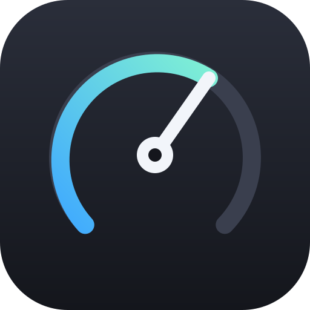

<p align="center"></p>

# Kadran

**Explore the OSCQuery devices of your network and play them on a page of controls.** A Pixel Stereo application, built on [pxs-qt](https://github.com/PixelStereo/pxs-qt).

<!-- release-downloads:start -->
**LATEST VERSION · [v0.3.3](https://github.com/PixelStereo/Kadran/releases/tag/v0.3.3)**

[](https://github.com/PixelStereo/Kadran/releases/download/v0.3.3/Kadran-macos-arm64-v0.3.3.zip)&nbsp;&nbsp;[](https://github.com/PixelStereo/Kadran/releases/download/v0.3.3/Kadran-macos-x64-v0.3.3.zip)&nbsp;&nbsp;[](https://github.com/PixelStereo/Kadran/releases/download/v0.3.3/Kadran-windows-x64-v0.3.3-Setup.exe)&nbsp;&nbsp;[](https://github.com/PixelStereo/Kadran/releases/download/v0.3.3/Kadran-linux-x64-v0.3.3.AppImage)&nbsp;&nbsp;[](https://github.com/PixelStereo/Kadran/releases/download/v0.3.3/Kadran-linux-arm64-v0.3.3.AppImage)
<!-- release-downloads:end -->

On a **Mac**, unzip, move Kadran to Applications and Control-click › Open the first time (it is signed ad hoc, not notarized). On **Windows**, run the installer. On **Linux**, make the AppImage executable and run it (or unpack the tar.gz).

Open Kadran and it opens in your browser (and on any phone, tablet or computer of the network, at the address it shows):

- **Devices** (left): found by mDNS, or added by hand (`+ Device`, `host:port`). Unfold one to read its namespace. Filter the addresses with the search field.
- **Plain OSC devices:** `+ Device`, choose *OSC*, give an IP address (or a host name) and the UDP port. The `_osc._udp` services of the network are offered in the dialog with their computer name; several ports of one host are several devices. A plain OSC device has no namespace to read: declare the addresses it takes with `+ Address…` (float, integer, on/off or trigger) and drag them on the page like any parameter. Rename a device with ✎, remove it with ✕ (only when no control shows it).
- A device that is gone from the network and that no control shows any more disappears by itself; one a control shows stays (offline) until the control is deleted.
- **Page** (right): drag an address onto it, double-click it, or right-click for the widget (fader, encoder, number, switch, buttons…). Two numbers make an XY pad, or two controls. Select several with Cmd/Ctrl-click or Shift-click.
- A control is a view of the remote parameter: it follows the device and writes back over OSC. Its address is shown on its tile.
- **Edit mode:** Cmd/Ctrl+E (or the Edit button): move, resize, restyle, add pages; a bin beside each page's name deletes it (undo brings it back). Cmd/Ctrl+K hides or shows the device explorer.
- **Signals:** the streams a device emits (a controller's knob, an incoming message) can be put on the page too: they show as a meter, a readout, a graph or a lamp, marked SIGNAL, and nothing can set them.
- **Keeping it:** what is on the page is saved as you work and comes back at the next launch. **Save** and **Open** keep named interfaces (`.kadran` files).

The page is served without a code, to the whole network: use it on a network you trust.

## Views, and driving Kadran by OSC

A **view** is a whole layout (its pages and tiles) kept under a name: *+ View* in the side panel keeps the page as it is, a click shows a view, double-click renames it, right-click deletes it. The page you see is the active view (what you change on it changes in it). The current view is the same on every browser: showing one shows it everywhere. The current page is too, unless Preferences › *Current page* is set to *One for each screen*. In edit mode, shift or Cmd/Ctrl-click or a rectangle selects several tiles; Cmd/Ctrl+C, X, V copy, cut and paste them, Delete removes them.

Kadran is an OSCQuery device itself (announced as *Kadran (computer name)*; the ports are in its window, UDP 47801 and HTTP 47802 by default), so Companion, QLab, a script or another Kadran can drive it:

| Address | What |
|---|---|
| `/kadran/page` (i) | the page shown, 1 for the first; written, it shows that page (on every screen, when the current page is shared) |
| `/kadran/pages/next`, `/kadran/pages/prev`, `/kadran/pages/<name>` | the next page, the previous one, that page |
| `/kadran/view` (s) | the view shown, by name; written, it shows that view |
| `/kadran/views/next`, `/kadran/views/prev`, `/kadran/views/<name>` | the same for the views |
| `/kadran/controls/<page>/<key>` | the value of a widget: a slider (f), a switch (T), a choice (s), an XY pad (ff), a button (an action). Written, it goes to the device the widget shows |

The multi-sliders, the ADSRs, the colors and the balls are not exposed yet.

## Multi-target interactions: one control, several parameters

Select two or more parameters in the tree, right-click, and pick *One control that sends to all of them*: a fader, a switch, a scene button (sends its values once, when pressed) or a hold button (high values when pressed, low ones when let go). Each target keeps its own range (its own to begin with), curve and, for a pad, axis; in edit mode the inspector lists them under *Sends to* (From, To, Curve; From above To inverts; the ✕ stops sending to one). Drag another address from the tree onto the macro's tile to send to it too. A macro keeps its own value: nothing is read back from the parameters.

When a tile sends to several targets, *Feedback from* in the inspector chooses which one gives the value the tile shows (taken back through its range and curve); *None* keeps the tile's own value.

## Filters

A slider or a switch can send its value through filters (smoothing, shape, timing, triggers: all the interaction filters of Pixel Stereo): in edit mode, *Filters* in the inspector, *+ Add a filter…*. They run in the order listed, on the value sent to the device; a smoothing goes on by itself after you let go.

## Build

Qt 6.4 or later, C++17.

```sh
git clone --recursive https://github.com/PixelStereo/Kadran.git
cd Kadran
./build.sh            # macOS, Linux (apt) and Windows (Git Bash; or build.cmd): installs what is missing, builds, opens Kadran
```

Or by hand:

```sh
cmake -S . -B build && cmake --build build
ctest --test-dir build
open build/Kadran*.app        # macOS; elsewhere run the executable
```

`build/kadran_fake_device` is a small OSCQuery device to try it on.

## Licence

GNU Affero General Public License v3.0 (see `LICENSE`).

### OSCQbench compatibility test

The OSCQbench test starts an independent Python OSCQuery fixture and drives
Kadran's Explorer. It checks action controls for `N` and `I`, rejection of a
read-only impulse, RGBA discovery and exact UDP bytes, binary WebSocket updates
after `LISTEN`, and refresh after `PATH_ADDED` and `PATH_REMOVED`.

The test needs Qt WebSockets, Python 3.8 or newer and the golden vectors from the
pxs-core tag `v0.17.0`.

```sh
cmake -S . -B build -DKADRAN_OSCQBENCH_VECTORS=/path/to/pxs-core/test/golden/vectors.tsv
cmake --build build --config Release --target kadran_oscqbench_client
ctest --test-dir build -C Release -R '^oscqbench$' --output-on-failure
```
